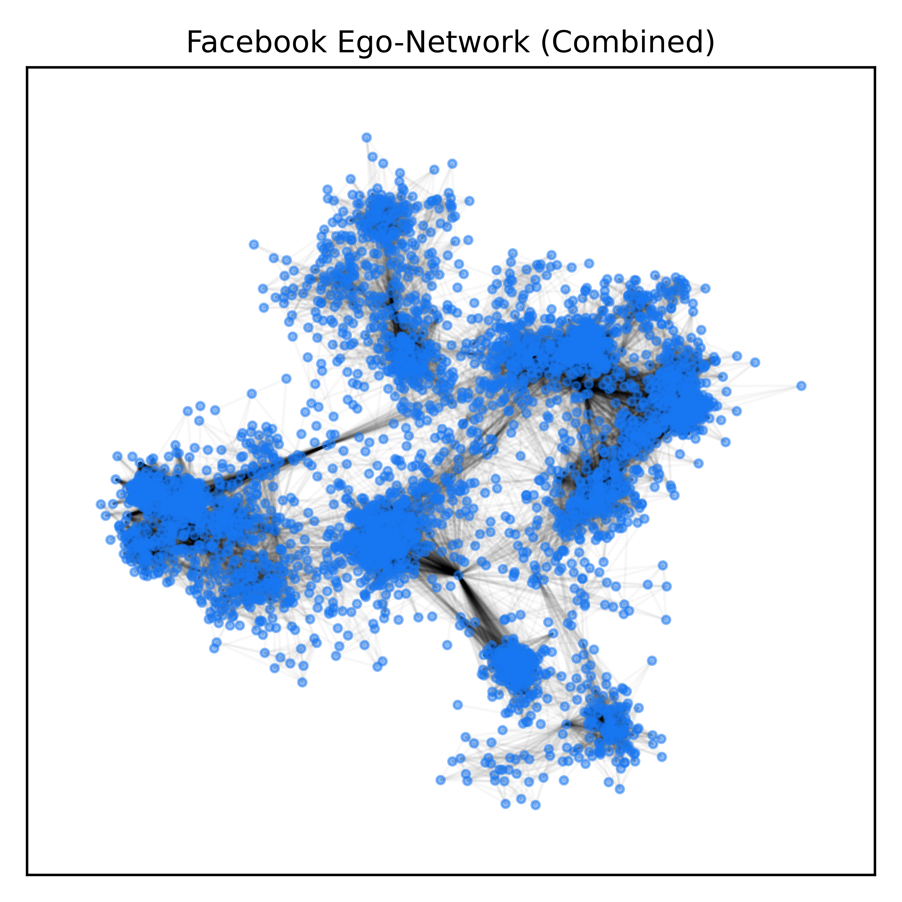
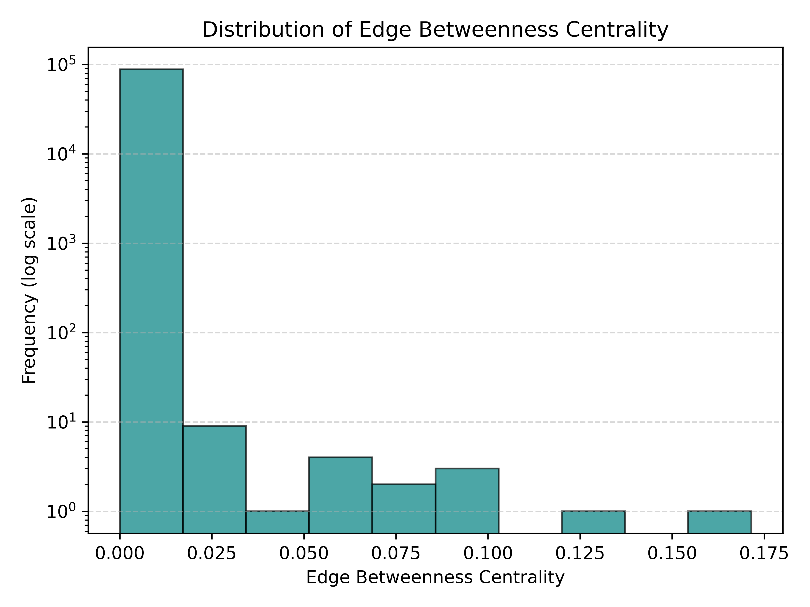
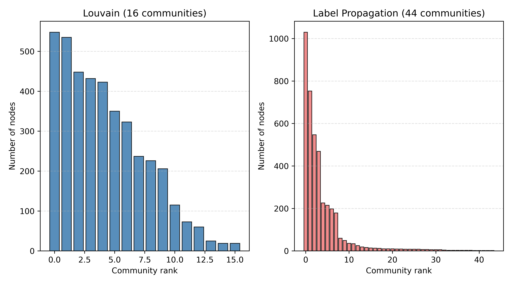

# Facebook Network Analysis

A structural analysis of a large undirected social network that reveals how connections are organised — from overall density to the bridges that hold communities together.

Built with Python and the **Facebook Combined** friendship network, this project uses NetworkX to compute core network metrics, measure edge importance, and detect communities so the underlying social structure can be understood.

## What This Project Does

Starting from a single edge-list file, the analysis runs through three connected stages:

- **Basic network metrics** — computes node/edge counts, density, and average degree, then visualises the overall structure.
- **Edge centrality** — measures which edges act as bridges across the network using edge betweenness centrality.
- **Community detection** — reveals natural social groups using two methods (Louvain and Label Propagation) and compares them.

## Key Findings

- **Overall structure.** The network has **4,039 nodes** and **88,234 edges** with very low density (~1%), meaning connections are sparse and most users have only a few links.
- **Bridges matter.** Edge betweenness centrality is extremely skewed — nearly all edges carry near-zero importance, while a small fraction connect otherwise separate communities. Removing them would fragment the network.
- **Community structure.** Both algorithms confirm strong groupings (Louvain modularity **0.835**). Louvain finds **16** larger, evenly-decaying communities, while Label Propagation finds **44** with a much steeper size distribution.

## Images

<table style="width: 100%; border-collapse: collapse;">
  <tr>
    <td style="border: 1px solid #ddd; padding: 10px; text-align: center;">
      
    </td>
    <td style="border: 1px solid #ddd; padding: 10px; text-align: center;">
      
    </td>
  </tr>
  <tr>
    <td style="border: 1px solid #ddd; padding: 10px; text-align: center;">
      
    </td>
    <td style="border: 1px solid #ddd; padding: 10px; text-align: center;">
      <i style="font-style: italic; color: #555;">Network visualisations and full metric summaries are available in the `assets/` folder.</i>
    </td>
  </tr>
</table>

## Getting Started

1. Place `facebook_combined-1.txt` in the repository root.
2. Run the notebook from the top cell — it loads the network and walks through each analysis stage in order.

No external setup is required beyond the packages listed above.
